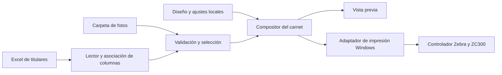

# Decisión tecnológica y arquitectura para imprimir carnets

Fecha: 23 de octubre de 2026. Estado: .NET y WPF elegidos; desarrollo, pruebas y operación directamente en Windows. La validación física de impresión sigue pendiente.

## 1. Decisión

Se utilizará **C# + WPF sobre .NET 10 LTS**, con desarrollo y pruebas directamente en Windows y el controlador Windows de Zebra para la ZC300. El solicitante eligió .NET y confirmó el uso directo de Windows después de revisar las implicaciones de WPF en macOS. La aplicación necesita sobre todo una impresión fiable con geometría física controlada.

WPF ofrece APIs para diálogo, capacidades, configuración y cola de impresión. Esto favorece una integración directa con Windows; sigue siendo necesario validar el controlador concreto. La selección de WPF es un juicio de ingeniería para este alcance, no una garantía de compatibilidad con todas las funciones de Zebra. [Documentación de impresión de WPF](https://learn.microsoft.com/en-us/dotnet/desktop/wpf/documents/printing-overview).

A la fecha de revisión, .NET 10 es una versión LTS con soporte publicado hasta el 14 de noviembre de 2028. Instalar una revisión vigente de esa rama y documentar sus actualizaciones. [Política de soporte de .NET](https://dotnet.microsoft.com/en-us/platform/support/policy/dotnet-core).

## 2. Alternativas evaluadas

Esta comparación conserva el fundamento de la elección; las alternativas no son decisiones pendientes ni tecnologías que se implementarán en paralelo. Las valoraciones son estimaciones relativas y no resultados de un benchmark.

| Opción | Interfaz | Impresión para este alcance | Coste o complejidad principal | Valoración |
| --- | --- | --- | --- | --- |
| .NET + WPF | XAML y C#, específica de Windows | APIs de Windows integradas; permite inspeccionar capacidades y trabajos | Probar la ruta WPF/controlador y preparar distribución para Windows | Primera opción |
| .NET + WinForms | Controles de Windows y C# | Alternativa directa con `PrintDocument` y dibujo mediante GDI | Más trabajo de presentación si se busca una interfaz muy cuidada | Viable para una utilidad sencilla |
| Tauri 2 + Rust | Habitualmente HTML/CSS/TypeScript con lógica en Rust | Requiere elegir y validar un adaptador de impresión de Windows | Integración nativa adicional y coordinación entre interfaz y backend | Preferible si se desea Rust con interfaz web |
| Rust + Slint | UI declarativa con integración Rust | La integración con la impresora se resuelve aparte de la UI | Adaptador Windows y revisión de condiciones de distribución de Slint | Alternativa si se busca evitar una interfaz web |
| Rust + Iced | UI definida en Rust | También necesita resolver la ruta de impresión | Construir e integrar esa capacidad y validar representación de textos | Viable si Rust es una prioridad del equipo |
| Electron | HTML/CSS/TypeScript y Node.js | API con selección de impresora, tamaño, copias y dúplex | Motor Chromium incluido y mantenimiento del runtime; validar CSS y controlador | Buena opción si predomina experiencia web |

Fuentes de las capacidades: [WinForms PrintDocument](https://learn.microsoft.com/en-us/dotnet/api/system.drawing.printing.printdocument), [arquitectura de Tauri](https://v2.tauri.app/concept/architecture/), [Slint](https://slint.dev/), [Iced](https://iced.rs/), [impresión en Electron](https://www.electronjs.org/docs/latest/api/web-contents#contentsprintoptions-callback).

### Qué tener en cuenta con Rust

Rust es viable. El punto decisivo es el camino entre el carnet compuesto y el controlador de la ZC300. Una interfaz gráfica atractiva no resuelve tamaño, orientación, caras, cinta, panel negro o tratamiento de fallos.

Tauri permite combinar una interfaz web con un núcleo Rust. Su API Rust `WebviewWindow::print()` documenta restricciones por plataforma; `window.print()` abre la vía de impresión web, pero por sí sola no ofrece el control de dispositivo requerido para dar por resuelto este proyecto. Propondría un adaptador Windows específico y una prueba física temprana antes de adoptar esta opción. Es una recomendación técnica, no una afirmación de que Tauri no pueda imprimir. [API de Tauri](https://docs.rs/tauri/latest/tauri/webview/struct.WebviewWindow.html#method.print).

Para una UI sin tecnologías web, evaluaría Slint e Iced con el mismo adaptador. La elección entre ambos depende de la experiencia del equipo y del diseño deseado. Las condiciones de licencia y distribución de Slint deben comprobarse para la modalidad elegida; no se presupone una licencia comercial de pago ni su gratuidad universal. [Modalidades publicadas de Slint](https://slint.dev/pricing).

### Qué tener en cuenta con Electron

Electron sí ofrece impresión con nombre de dispositivo, dimensiones personalizadas, copias y modalidad dúplex. Es una alternativa razonable si el dominio de tecnologías web ahorra tiempo de desarrollo. Hay que probar el resultado con el controlador y evitar que reglas CSS o ajustes de escala alteren la tarjeta. [API de impresión](https://www.electronjs.org/docs/latest/api/web-contents#contentsprintoptions-callback).

Incluye Chromium y Node.js con la aplicación. Para esta utilidad eso aporta un coste de distribución y actualización que WPF no necesita en forma de navegador; el tamaño y consumo reales deben medirse sobre un prototipo y no asignarse por cifras genéricas. [Arquitectura y distribución de Electron](https://www.electronjs.org/docs/latest/why-electron).

## 3. Arquitectura mínima con .NET

- Una aplicación de escritorio, sin servidor ni servicio de fondo.
- Lector de `.xlsx` sin automatizar Microsoft Excel. Seleccionar la biblioteca tras revisar su licencia y comprobar lectura de fechas, valores calculados e identificadores con formato.
- Datos de titulares y resumen de impresión en memoria durante la sesión. Ajustes pequeños en archivos locales versionados. No incorporar SQLite, un catálogo de personas ni historial persistente en el MVP.
- Un compositor que recibe datos, foto y diseño, y produce la representación de cada cara con medidas físicas definidas. Compartir reglas entre vista previa e impresión.
- Un adaptador aislado para capacidades y envío a la cola de Windows. Usar las propiedades del controlador para opciones de Zebra que no exponga el camino estándar.
- No integrar un SDK de Zebra al inicio. Evaluarlo únicamente si las pruebas muestran una necesidad concreta que el controlador no cubre. No suponer que una API de etiquetas o comandos ZPL es el mecanismo correcto para una impresora de tarjetas.

El arte final debe incluir fondos y logos limpios. Las fotos del carnet de referencia permiten entender el resultado, pero no sustituyen los archivos de diseño.

## 4. Validación de la integración con la impresora

Esta prueba es trabajo futuro; no se ha ejecutado en esta etapa de especificaciones.

1. Documentar Windows, controlador, conexión, material, cinta y capacidades instaladas de la ZC300.
2. Componer el carnet de referencia con datos ficticios que respeten los once campos del Excel, fotografía y dimensiones definitivas.
3. Imprimir una tarjeta por ambas caras y comprobar legibilidad, escala, posición, giro, orden y asociación. Identificar si se utiliza dúplex automático o reinserción manual guiada.
4. Imprimir dos titulares distintos en un lote pequeño, incluidos textos largos. Confirmar que no se cruzan fotos o reversos. En modo manual, completar una tarjeta antes de comenzar la siguiente.
5. Verificar comportamiento con impresora desconectada y con interrupción de un lote; distinguir envío a la cola de salida física.
6. Repetir desde el paquete instalado, con Internet desconectado y en el escalado de pantalla habitual.

Criterio para aceptar el adaptador: cumplir los escenarios de impresión de la sección 8 de las especificaciones para las modalidades habilitadas y documentar los ajustes del controlador. Si la ruta WPF no satisface algún punto, investigar la configuración o un adaptador GDI dentro de la misma aplicación antes de reconsiderar la interfaz.

## 5. Organización de la solución

Tres proyectos son suficientes; no se requiere una arquitectura de servicios:

- `Carnets.Core`: modelo del titular, normalización, validación, búsqueda, selección y planificación de tarjetas. No depende de ventanas o impresoras.
- `Carnets.Desktop`: WPF, patrón MVVM, lectura de Excel y archivos locales, composición visual, configuración y adaptador de impresión Windows.
- `Carnets.Tests`: pruebas de las reglas de datos y planificación. Las pruebas que requieren la ZC300 se ejecutan en la estación documentada.

El proyecto de escritorio utiliza un destino de Windows de .NET 10 y se compila y ejecuta en Windows. La arquitectura y el paquete de distribución se seleccionan según la estación real, sin prometer compatibilidad con un controlador que no se haya comprobado. Los paquetes de terceros se fijarán a versiones concretas durante la implementación y deberán permitir la distribución prevista.

## 6. Contratos de datos y configuración

### Titular cargado

El modelo conserva los once campos definidos en las especificaciones, el número de fila de origen, los errores y advertencias, y la referencia resuelta de la foto. Matrícula y cédula se almacenan como texto; las dos fechas, como fechas sin hora. El orden de filas, el índice visual y el nombre completo no se utilizan como identificador de impresión.

### Perfil del carnet

Un perfil JSON versionado define tamaño en milímetros, orientación horizontal, fondos, logo, elementos institucionales y bloques de firmas, fuente y tamaño de cada campo, límites de texto y marco de fotografía. Frente y reverso son composiciones independientes. Cada elemento variable se vincula por el nombre interno de campo de la sección 4 de las especificaciones.

Los recursos gráficos se distribuyen con el perfil y se referencian de forma relativa a su carpeta. No se requiere un editor visual del perfil. Los ajustes de recorte de un titular pertenecen a la sesión y no modifican el modelo general.

### Ajustes del operador

Archivo JSON versionado bajo `%LocalAppData%` en una subcarpeta de la aplicación, separado del programa instalado: asociación de columnas, última carpeta de fotos, impresora seleccionada, modalidad de impresión, offsets por cara, giro de reverso y orientación/instrucciones de reinserción validadas. Se guarda al confirmar los ajustes; no conserva filas del Excel ni fotografías. La aplicación no necesita abrir automáticamente el último archivo de personas.

### Plan de impresión

Al confirmar, capturar la lista ordenada de matrículas, caras, copias, perfil y ajustes. Deshabilitar cambios que invaliden ese plan mientras se procesa. Los resultados se relacionan con ese plan y distinguen trabajos aceptados por Windows de tarjetas verificadas físicamente.

En modo automático, un trabajo contiene las dos caras consecutivas del titular y la cantidad de copias; en modo manual, cada ciclo identifica titular y copia, y envía una sola cara antes de solicitar intervención. La recuperación de una cara es una operación nueva y explícita. Una excepción o un reinicio nunca reanudan automáticamente la impresión.

## 7. Orden de implementación y comprobación

1. Registrar la estación y comprobar impresión básica a dos caras, automática o manual, con un patrón de calibración. Resolver esta integración antes de completar toda la interfaz.
2. Implementar lectura y validación del Excel incluido, asociación de fotos y selección estable. Verificar encabezados con espacios, matrícula, fechas y errores por fila.
3. Construir frente y reverso limpios a partir de las fotografías, utilizando un único compositor para vista previa y salida de cada cara.
4. Integrar confirmación, conteos, modalidad manual o automática, detención y resumen de errores. Verificar duplicación por doble clic y lotes parcialmente enviados.
5. Preparar el paquete instalable y la guía de operación y ejecutar los 25 criterios de aceptación de [especificaciones-carnets.md](especificaciones-carnets.md), registrando los escenarios no aplicables a las capacidades instaladas.

La elección de tecnología queda cerrada. Quedan por ejecutar la implementación y la validación física, y por preparar los recursos gráficos con calidad de impresión; no se atribuye a esta documentación una prueba de compatibilidad ya realizada.

El orden anterior se detalla en el [plan de implementación por etapas](plan-implementacion.md), que sirve como lista de trabajo y registro de avance al comenzar en Windows.
