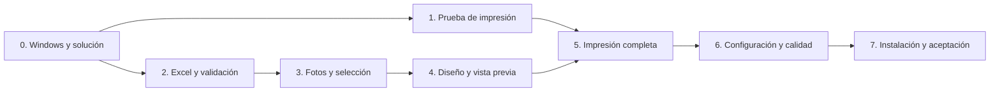

# Plan de implementación por etapas

Fecha: 23 de octubre de 2026. Base: especificaciones versión 1.0. Estado: aplicación y paquete de evaluación implementados; aceptación física y arte final pendientes.

## 1. Punto de partida

La aplicación se desarrollará, probará y utilizará directamente en Windows con C#, WPF y .NET 10. La impresora objetivo es la Zebra ZC300. El Excel incluido aporta los once campos y las fotografías aportan la composición del frente y del reverso.

Documentos de referencia, en orden de lectura:

1. [Especificaciones funcionales y criterios de aceptación](especificaciones-carnets.md).
2. [Decisión tecnológica y arquitectura](evaluacion-tecnologica.md).
3. [Análisis del material de referencia](analisis-material.md).

Al preparar este plan existen los documentos y los materiales de referencia; todavía no hay solución .NET ni pruebas de la aplicación. Todas las tareas siguientes empiezan pendientes. Este plan organiza la implementación y no cambia el alcance de las especificaciones.

## 2. Secuencia y dependencias

| Etapa | Resultado | Dependencia para cerrarla |
| --- | --- | --- |
| 0 | Estación preparada y solución mínima ejecutándose | Acceso a Windows |
| 1 | Ruta de impresión de dos caras comprobada | Etapa 0 y acceso a la ZC300 |
| 2 | Excel leído, asociado y validado | Etapa 0 |
| 3 | Fotos resueltas y selección estable | Etapa 2 |
| 4 | Frente y reverso compuestos y revisables | Etapa 3 |
| 5 | Flujo completo de impresión y recuperación | Etapas 1 y 4 |
| 6 | Configuración, operación y rendimiento consolidados | Etapa 5 |
| 7 | Paquete instalado y aceptación física documentada | Etapa 6, arte final y ZC300 |

El orden recomendado es 0 → 1 → 2 → 3 → 4 → 5 → 6 → 7. Si falta temporalmente la impresora, se puede avanzar en 2, 3 y 4. La etapa 1 conserva su estado pendiente y la impresión no se declara validada por haber generado una vista previa o un documento de prueba.

## 3. Etapa 0: preparar Windows y crear la solución

**Objetivo:** disponer de un punto de partida que compile y se ejecute en la computadora donde se desarrollará.

- [x] E0.1. Abrir la carpeta completa del proyecto en Windows y comprobar que se trasladaron el Excel, el RAR, las cuatro fotografías, el video y los documentos.
- [x] E0.2. Registrar versión y arquitectura de Windows. Instalar el SDK de .NET 10 y un entorno compatible con C# y WPF; comprobar el SDK con `dotnet --info` y `dotnet --list-sdks` desde una terminal nueva.
- [x] E0.3. Crear una solución `Carnets` con `src/Carnets.Core`, `src/Carnets.Desktop` y `tests/Carnets.Tests`. El escritorio usa WPF y un destino Windows de .NET 10; referencia a Core. Tests comienza comprobando las reglas de Core.
- [x] E0.4. Configurar la versión del SDK, las dependencias iniciales y las exclusiones de archivos generados. Registrar los comandos de compilación, prueba y ejecución en el README. Inicializar Git si todavía no existe y comprobar qué materiales deben permanecer locales antes de incorporar archivos al control de versiones.
- [x] E0.5. Abrir una ventana WPF mínima y comprobar que la solución compila y que el proyecto de pruebas puede ejecutarse. Una plantilla vacía de pruebas no cuenta como validación funcional.
- [x] E0.6. Crear `docs/verificacion-windows.md` para registrar entorno, decisiones de impresora y resultados observados. Anotar datos técnicos sin copiar datos personales de los titulares.

**Entregable:** solución mínima, instrucciones reproducibles y ficha del entorno.

**Condición de cierre:** una ventana WPF se abre en Windows y otra compilación desde terminal funciona con la configuración documentada. No se exige instalar Microsoft Excel.

## 4. Etapa 1: comprobar la impresión en la ZC300

**Objetivo:** resolver tamaño físico, alimentación y ambas caras antes de construir toda la interfaz.

- [ ] E1.1. Instalar o comprobar el controlador Windows de Zebra. Registrar versión, nombre exacto de la cola, conexión, tipo de cinta, material y opciones instaladas. Confirmar si la unidad tiene dúplex automático.
- [x] E1.2. Crear una composición WPF de prueba CR80 horizontal con marcas de calibración, texto ficticio y caras claramente distintas. Utilizar un punto de entrada de diagnóstico dentro de la solución; no construir una segunda aplicación de producción.
- [ ] E1.3. Implementar el adaptador mínimo para enumerar impresoras, elegir expresamente la ZC300, configurar tamaño/orientación y enviar un trabajo. Comprobar que se distingue aceptación de la cola de salida física.
- [ ] E1.4. Imprimir por ambas caras. Si existe dúplex, comprobar orden y giro; si se necesita modo manual, comprobar alimentación y reinserción con una sola tarjeta. Documentar pasos y orientación con un esquema sencillo.
- [ ] E1.5. Medir escala y desplazamiento en tres tarjetas y registrar offsets por cara y giro del reverso. Comprobar también impresora ausente y fallo de envío sin cambiar a una impresora alternativa.
- [ ] E1.6. Registrar la ruta elegida y sus límites. Si el controlador no resuelve una función necesaria, investigar primero sus opciones y el adaptador Windows/GDI; justificar una integración adicional antes de incorporarla.

**Entregable:** prueba física de ambas caras y perfil inicial de impresora/calibración.

**Condición de cierre:** existe una modalidad comprobada que produce correctamente frente y reverso. Si ninguna funciona, registrar el fallo concreto y resolverlo antes de cerrar esta etapa. Los resultados con el patrón de prueba no sustituyen la aceptación posterior del carnet definitivo.

## 5. Etapa 2: leer el Excel y validar sus datos

**Objetivo:** convertir el archivo incluido en registros utilizables, sin perder información ni modificar la fuente.

- [x] E2.1. Definir el modelo del titular con los once campos, matrícula como identificador, fila de origen y errores/advertencias. Conservar matrícula, cédula y exequátur como texto y las fechas sin hora.
- [x] E2.2. Elegir un lector `.xlsx` compatible con la distribución prevista. Verificar licencia y comportamiento con fechas, valores calculados e identificadores con formato; fijar la versión utilizada. Leer archivos sin automatizar Excel ni ejecutar cálculos o conexiones externas.
- [x] E2.3. Implementar selección de archivo y hoja, reconocimiento de los once encabezados, normalización y asociación manual cuando falten coincidencias o haya ambigüedad. Mostrar columnas adicionales sin convertirlas en campos nuevos del carnet.
- [x] E2.4. Implementar validación por fila: obligatorios, matrículas duplicadas, fechas inválidas, expiración anterior a admisión y advertencia de vencimiento. Aplicar `-` a segundo nombre/apellido vacíos conforme al diseño.
- [x] E2.5. Conservar la carga anterior si falla un archivo nuevo. Al recargar correctamente, limpiar la selección y preservar la referencia a la hoja y fila original para los errores.
- [x] E2.6. Añadir pruebas con el esquema del archivo incluido y variantes sintéticas: encabezados con espacios/acentos, reordenados o duplicados; matrícula con ceros; fechas de Excel y texto; fórmula sin valor disponible; archivo inválido. Mantener intactos los materiales originales.

**Entregable:** tabla de titulares, asociación de columnas y validación comprobada.

**Condición de cierre:** el archivo incluido produce dos registros y once campos correctamente asociados; las variantes inválidas producen errores localizados. Se pueden revisar CA-01, CA-02, CA-03, CA-04 y CA-20.

## 6. Etapa 3: resolver fotos y seleccionar titulares

**Objetivo:** elegir exactamente a quién imprimir y mantener su relación con la fotografía.

- [x] E3.1. Extraer las imágenes del RAR a una carpeta local de trabajo. La aplicación utilizará una carpeta de fotos; no necesita descomprimir RAR como función del producto.
- [x] E3.2. Implementar la resolución de `FOTOS`: ruta absoluta existente, ruta relativa o nombre bajo la carpeta elegida. Ofrecer reasociación explícita cuando una ruta pertenezca a otra computadora.
- [x] E3.3. Resolver por matrícula únicamente cuando `FOTOS` esté vacío; gestionar coincidencias múltiples, archivos ausentes e ilegibles, y advertir resolución efectiva inferior a 150 ppp. No sustituir automáticamente una referencia explícita fallida.
- [x] E3.4. Incorporar encuadre centrado y ajuste de recorte en memoria, sin deformar ni modificar las fotos originales.
- [x] E3.5. Implementar búsqueda por matrícula, cédula, nombre y apellido; selección individual y de resultados filtrados; conteo de seleccionados ocultos y limpieza total. Mantener identidad y foto al ordenar o filtrar.
- [x] E3.6. Verificar rutas trasladadas, dos extensiones para una matrícula, foto corrupta, cambio de selección y filtros. Comprobar que una fila con error nunca muestra la foto del titular anterior.

**Entregable:** selección estable y fotos preparadas para composición.

**Condición de cierre:** se cumplen CA-05, CA-06 y CA-19. La detección de cambios de foto de CA-24 queda preparada para integrarse con el envío en la etapa 5.

## 7. Etapa 4: construir el carnet y la vista previa

**Objetivo:** reproducir la composición de referencia con dimensiones físicas controladas.

- [ ] E4.1. Preparar logo, fondo y firmas a partir de originales o de una extracción de calidad revisable. Mantener los gráficos separados de los datos variables; usar marcadores provisionales solo durante desarrollo y registrar los recursos que falten.
- [x] E4.2. Crear el perfil JSON versionado con lienzo CR80 horizontal, recursos relativos, fuentes, posiciones, límites de texto y marco de foto.
- [x] E4.3. Construir el frente con diez valores textuales y fotografía, respetando las cinco filas de dos campos. Vincular `FILIAL` a Provincia y conservar separados los dos nombres y los dos apellidos.
- [x] E4.4. Construir el reverso fijo con su cabecera, leyenda y bloques de firmas. Usar el mismo reverso para todos los titulares.
- [x] E4.5. Implementar un compositor de cada cara compartido por vista previa e impresión. Añadir cambio de cara y zoom, ajuste de texto hasta 7 puntos y error de desbordamiento cuando no quepa.
- [x] E4.6. Revisar el diseño con datos sintéticos normales y extremos, opcionales vacíos y fotos de proporciones distintas. Comparar distribución y textos con las fotografías de referencia.

**Entregable:** perfil del carnet, frente/reverso y vista previa vinculada a la selección.

**Condición de cierre:** CA-07, CA-16 y CA-17 se cumplen en composición; las posiciones físicas y el arte definitivo se vuelven a comprobar en la etapa 7. Los recursos provisionales impiden cerrar la aceptación visual final, pero no el trabajo de composición.

## 8. Etapa 5: integrar impresión, estados y recuperación

**Objetivo:** completar el flujo desde una selección válida hasta el seguimiento de sus envíos.

- [x] E5.1. Crear el plan de impresión con orden, matrículas, caras, copias, perfil e impresora. Mostrar toda la selección antes de confirmar, incluidos los resultados ocultos por filtros. Validar copias enteras de 1 a 100 y reconocimiento de vencimientos.
- [x] E5.2. Bloquear cambios incompatibles durante la preparación/envío, comprobar recursos y detectar fotos cambiadas o eliminadas después de revisarlas. Impedir doble envío por doble clic y mostrar errores de la selección sin excluir filas silenciosamente.
- [ ] E5.3. Integrar dúplex automático cuando esté disponible: un trabajo por titular con frente y reverso consecutivos y cantidad de copias. Verificar físicamente asociación y conteos con dos titulares distintos.
- [ ] E5.4. Integrar la secuencia manual cuando sea necesaria: titular y copia bloqueados, frente, pausa, reinserción confirmada y reverso. No pasar a la tarjeta siguiente sin resolver la actual. Si la estación utiliza solo dúplex automático, documentar esta condición y el estado del modo manual, sin habilitar una modalidad no verificada.
- [x] E5.5. Implementar estados y resumen de sesión: enviado a la cola, pendiente, incompleto, error y resultado desconocido. Conservar identificadores de trabajos cuando sea posible, sin afirmar emisión física por la sola aceptación de Windows.
- [x] E5.6. Implementar detención de nuevos envíos y recuperación explícita de una cara con identificación del titular. Nunca reintentar tras una incertidumbre ni reanudar al reiniciar.
- [ ] E5.7. Probar conteos, duplicación, cancelación previa, selección inválida y transiciones con un adaptador simulado. Probar en la ZC300 errores de envío, interrupción parcial y las modalidades habilitadas; registrar lo que la cola permite conocer y lo que debe revisar el operador.

**Entregable:** flujo completo, resumen de sesión y recuperación controlada.

**Condición de cierre:** se verifican CA-08, CA-09, CA-10, CA-11, CA-12, CA-18, CA-23, CA-24 y CA-25 según las capacidades de la estación. Los escenarios de una modalidad no instalada se justifican como no aplicables; todos los comportamientos de la modalidad usada se prueban físicamente.

## 9. Etapa 6: consolidar configuración y operación

**Objetivo:** hacer que la aplicación sea utilizable entre sesiones y en condiciones normales de la estación.

- [x] E6.1. Guardar asociación de columnas, carpeta de fotos, impresora, modalidad y calibración bajo el usuario Windows con esquema versionado y escritura atómica. Separar ajustes del operador de los recursos del programa instalado.
- [x] E6.2. Gestionar configuración corrupta o incompatible mediante restablecimiento explícito. Conservar ajustes compatibles entre versiones y no almacenar filas del Excel, fotos, recortes por titular ni historial persistente.
- [x] E6.3. Confirmar pérdida de recortes cuando corresponda al cerrar o recargar. Verificar que abrir la aplicación no restaura una selección lista para imprimir ni envía trabajos.
- [ ] E6.4. Revisar navegación por teclado, mensajes con hoja/fila/campo y escalados de pantalla de 100 %, 125 % y 150 %. Mantener operativa la interfaz durante carga, preparación y seguimiento de trabajos.
- [x] E6.5. Medir arranque, carga de 1.000 filas sintéticas y actualización de vista previa en la estación documentada. Corregir únicamente los problemas que impidan cumplir los objetivos de las especificaciones.
- [ ] E6.6. Verificar el flujo con Internet desconectado y revisar que los registros técnicos no incluyan datos personales ni imágenes. Añadir regresiones de configuración y de las reglas que hayan fallado durante la integración.

**Entregable:** configuración persistente, interfaz operativa y resultados de rendimiento.

**Condición de cierre:** CA-14, CA-15, CA-21 y CA-22 comprobados; repetición de CA-02 y CA-12 tras cerrar/reabrir y recargar.

## 10. Etapa 7: instalar y aceptar el resultado

**Objetivo:** entregar una aplicación que funcione desde su paquete de distribución y produzca el carnet definitivo.

- [x] E7.1. Preparar el paquete para la arquitectura Windows de la estación, incluir recursos del perfil y resolver los componentes de ejecución de .NET. Documentar instalación del controlador de Zebra y requisitos para trabajar sin conexión.
- [ ] E7.2. Instalar desde el paquete en un entorno de prueba o perfil limpio y ejecutar sin depender de rutas del desarrollador ni permisos de administrador para el uso diario. Verificar actualización conservando ajustes compatibles.
- [ ] E7.3. Imprimir el diseño definitivo con arte limpio y datos controlados. Revisar frente, reverso, foto, leyendas, firmas, escala, posición y legibilidad en tres tarjetas consecutivas conforme a las tolerancias especificadas.
- [x] E7.4. Completar la matriz de los 25 criterios de aceptación con resultado, evidencia y defectos pendientes. Documentar los no aplicables por modalidad instalada; no marcar como aprobados escenarios no ejecutados.
- [x] E7.5. Entregar guía breve en español: cargar Excel, elegir carpeta de fotos, corregir errores, revisar selección, imprimir, reinsertar si corresponde, recuperar una cara y consultar la cola de Windows.
- [ ] E7.6. Entregar código fuente, paquete instalable, perfil final y ficha de configuración de la estación. Retirar o restringir las acciones temporales de diagnóstico para que no se confundan con la operación habitual.

**Entregable:** paquete instalado y documentación de aceptación.

**Condición de cierre:** todos los criterios aplicables aprobados, evidencia física registrada y ningún defecto pendiente que impida imprimir ambas caras correctamente. CA-13 se acepta aquí con el diseño final, no únicamente con el patrón de la etapa 1.

## 11. Cobertura de los criterios de aceptación

Las referencias CA corresponden a la sección 8 de las especificaciones. La etapa indica dónde se comprueba principalmente el criterio; la etapa 7 reúne los resultados y repite lo afectado por cambios posteriores.

| Etapa principal | Criterios |
| --- | --- |
| 2: Excel | CA-01, CA-02, CA-03, CA-04, CA-20 |
| 3: fotos y selección | CA-05, CA-06, CA-19 |
| 4: composición | CA-07, CA-16, CA-17 |
| 5: impresión y errores | CA-08, CA-09, CA-10, CA-11, CA-12, CA-18, CA-23, CA-24, CA-25 |
| 6: operación y configuración | CA-14, CA-15, CA-21, CA-22 |
| 7: aceptación física | CA-13 |

## 12. Cómo retomar y registrar avances

Marcar una tarea como completada solo cuando exista su entregable y se haya realizado su comprobación. Al finalizar una sesión, actualizar esta tabla, las casillas afectadas y `docs/verificacion-windows.md`. Registrar los problemas concretos y su siguiente acción; no confundir la ausencia temporal de impresora con un fallo de los componentes que pueden probarse sin ella.

| Etapa | Estado actual | Evidencia actual |
| --- | --- | --- |
| 0 | Completada | Solución compilada, 34 pruebas y ventana WPF abierta; ver verificacion-windows.md |
| 1 | Pendiente de hardware | Patrón y adaptador implementados; sin ZC300 real |
| 2 | Implementada y probada en software | Excel real, asociaciones y recarga; ver aceptacion.md |
| 3 | Implementada y probada en software | Dos fotos originales, selección/filtro/orden y encuadre |
| 4 | Composición implementada; arte pendiente | Perfil configurable, vistas y mínimo de 7 pt; faltan originales institucionales |
| 5 | Simulación probada; físico pendiente | Automático/manual, fallos, detención y recuperación; sin validación ZC300 |
| 6 | Parcial | Configuración, rendimiento y paquete probados; falta escalado real y red desconectada |
| 7 | Paquete de evaluación disponible | Instalador por usuario y matriz; aceptación física no completada |

**Siguientes acciones: incorporar arte institucional original, ejecutar la etapa 1 con una ZC300 real y completar los escenarios pendientes de aceptacion.md. La simulación no cierra la aceptación física.**

Mensaje sugerido para iniciar una nueva sesión de desarrollo:

> Lee `docs/aceptacion.md`, `docs/verificacion-windows.md` y este plan. La aplicación, las pruebas y el paquete de evaluación ya existen. Revalida el estado de main y comienza por un requisito pendiente: arte institucional, estación Zebra o escenarios de aceptación real. Conserva los materiales originales y no marques pruebas físicas como aprobadas a partir del simulador.
